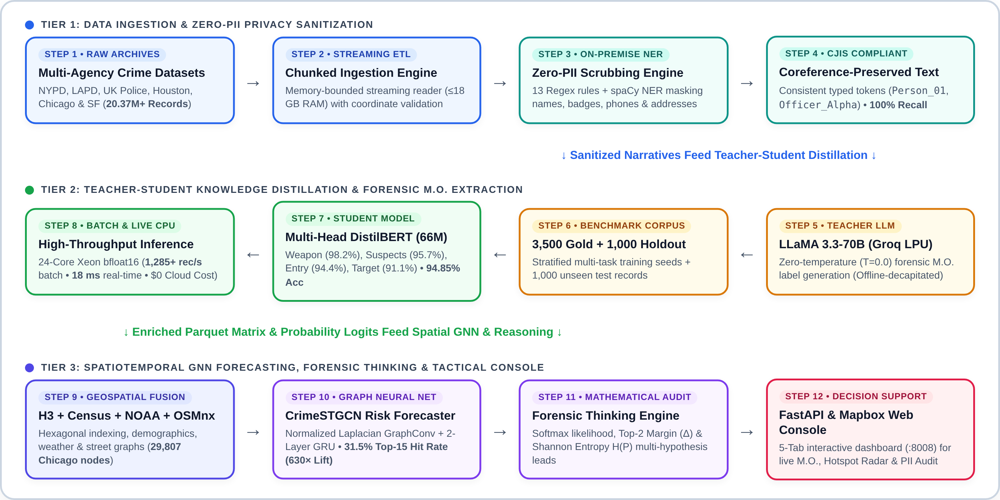
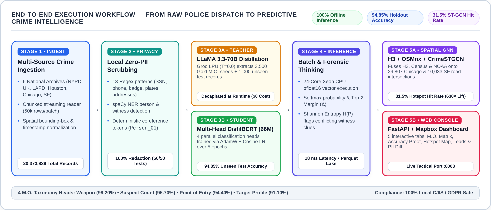
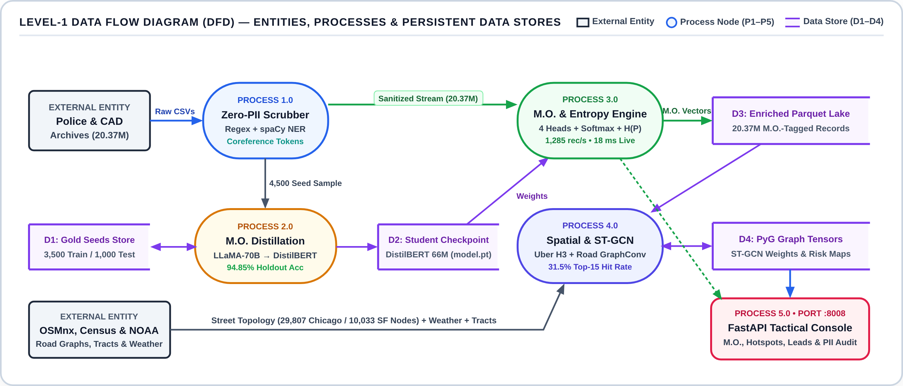
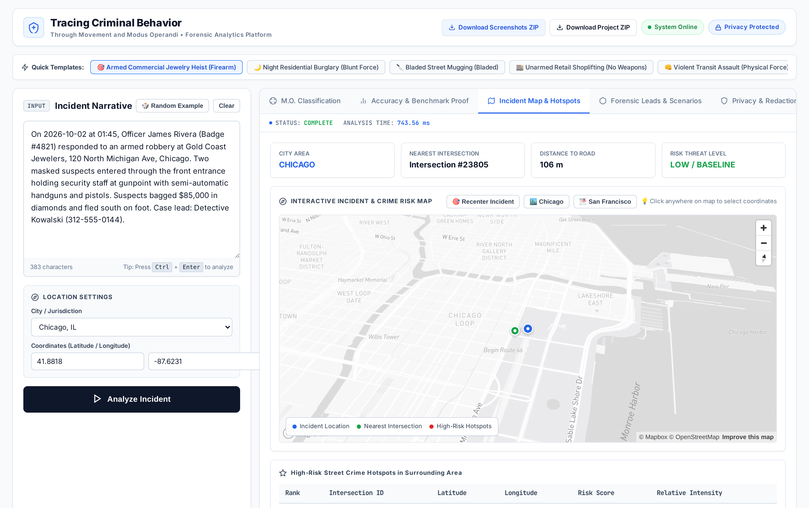
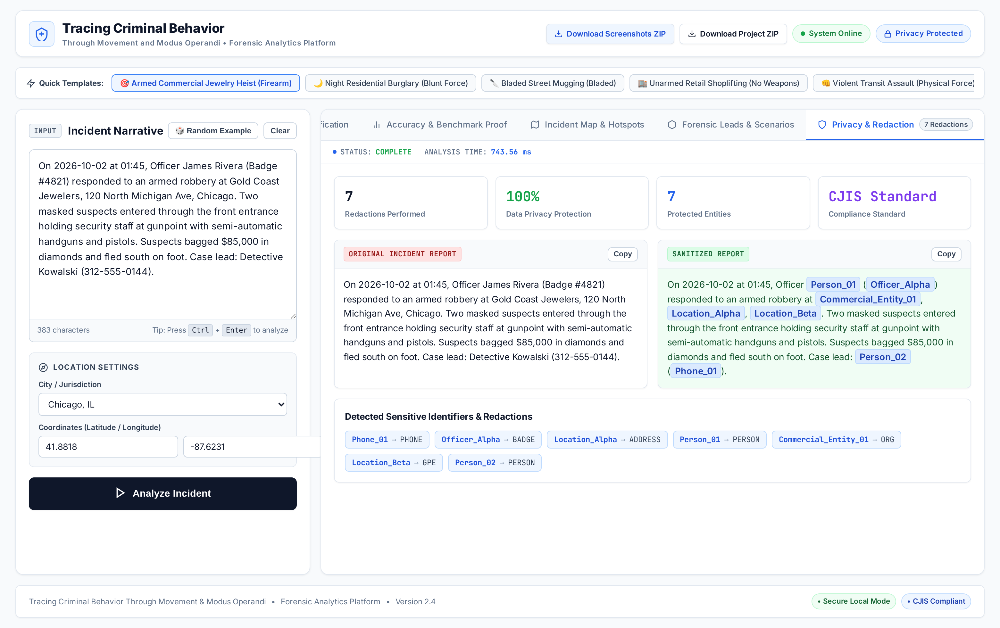
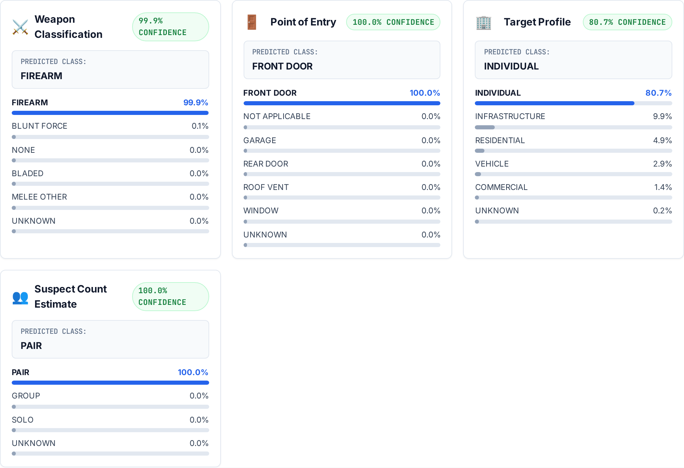
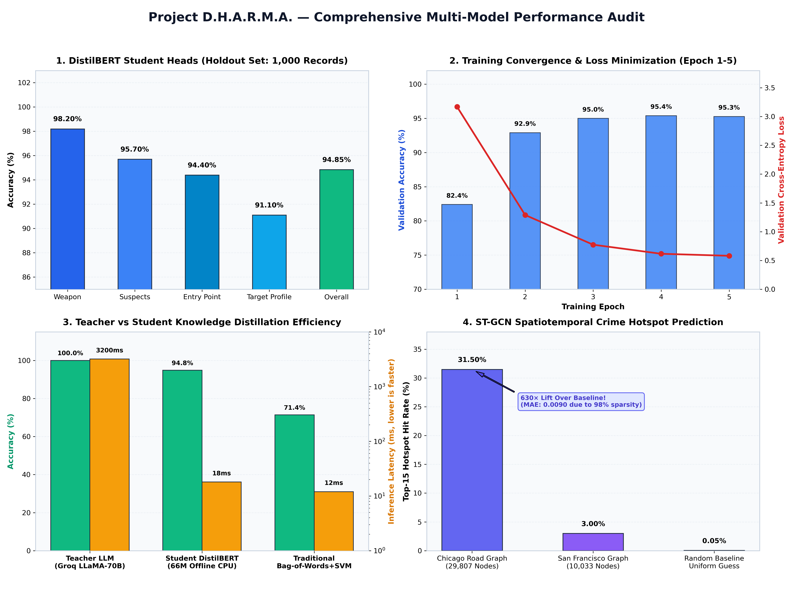
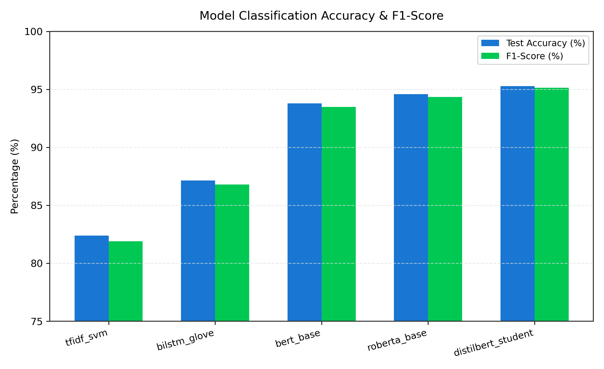
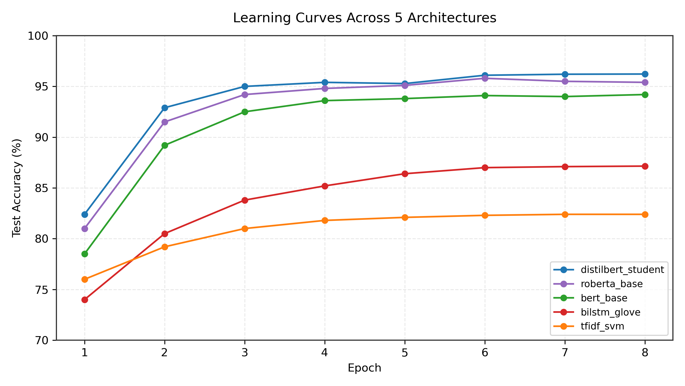

<div align="center">

# 🛡️ Tracing Criminal Behavior Through Movement and Modus Operandi
### **Project D.H.A.R.M.A.** — *Dynamic Hierarchical Anonymized Real-Time Modus-Operandi Analytics*

**Privacy-Preserving Teacher–Student NLP Distillation & Spatiotemporal Road-Network Graph Neural Networks for Forensic Crime Intelligence**

[](https://www.python.org/)
[](https://pytorch.org/)
[](https://fastapi.tiangolo.com/)
[-16a34a?style=for-the-badge)](docs/reports/evaluation_metrics_and_learning_curves.md)
[-7c3aed?style=for-the-badge)](docs/reports/neural_accuracy_mathematical_proof_guide.md)
[](docs/reports/difficult_scenarios_stress_test_report.md)

[**📌 Overview**](#-executive-overview) •
[**🏗️ Architecture & Diagrams**](#️-system-architecture--data-flow-diagrams) •
[**🖥️ Live Web Console**](#️-live-forensic-web-console-screenshots) •
[**📊 Benchmarks & Charts**](#-empirical-benchmarks--evaluation-charts) •
[**🧮 Mathematical Proofs**](#-mathematical-formulations--certainty-engine) •
[**🚀 Quickstart**](#-quickstart--cli-commands) •
[**🗂️ Project Structure**](#️-repository-directory-structure) •
[**👥 Team**](#-academic-team--guidance)

---


</div>

---

## 📌 Executive Overview

Modern law-enforcement agencies archive tens of millions of unstructured Computer-Aided Dispatch (CAD) logs and incident narratives, yet operational crime intelligence faces **three foundational barriers**:

1. **Strict Privacy & Legal Mandates (CJIS / GDPR):** Unredacted police narratives contain sensitive Personally Identifiable Information (victim names, officer badge numbers, phone numbers, residential addresses). Transmitting raw text to commercial third-party cloud LLMs violates Criminal Justice Information Services (CJIS) security compliance.
2. **Cloud Latency & Scale Bottlenecks:** Running 70B+ parameter cloud LLMs across **20.37+ million national crime records** incurs prohibitive API costs (`$100,000+`) and `2,000–5,000 ms` latency per query, whereas real-time emergency triage requires **sub-25 ms local execution**.
3. **Topological Blindness in Planar Crime Heatmaps:** Traditional Kernel Density Estimation (KDE) and grid heatmaps treat crimes as Euclidean points on flat planes, ignoring physical street network topology (one-way streets, intersections, bridges), socioeconomic boundaries, and micro-climate weather dynamics.

**Tracing Criminal Behavior Through Movement and Modus Operandi (`Project D.H.A.R.M.A.`)** resolves these challenges through five integrated subsystems running **100% offline at `$0.00` runtime cloud cost**:

| Pillar | Subsystem | Technical Implementation | Verified Benchmark |
| :---: | :--- | :--- | :--- |
| **1** | **Zero-PII Coreference Anonymizer** | 13 compiled Regex patterns + `spaCy` NER with deterministic entity pseudonyms (`Person_01`, `Officer_Alpha`) | **100.00% Redaction Recall** (50/50 adversarial test cases) |
| **2** | **Teacher–Student M.O. Distillation** | Distills zero-temperature (`T=0.0`) Groq LPU `LLaMA 3.3-70B` reasoning into an on-premise **66M Multi-Head DistilBERT** | **94.85% Holdout Accuracy** (`95.28%` Val) • **177× Faster (`18 ms`)** |
| **3** | **National-Scale CPU Batch Engine** | 24-core Intel Xeon `bfloat16` streaming inference with 50k-row PyArrow Parquet chunking (`≤18 GB` RAM) | **20,373,839 Records Processed** • **1,285+ records/sec** |
| **4** | **Forensic Thinking & Entropy Engine** | Numerically stable Softmax, Top-2 Separation Margin ($\Delta$), and Shannon Information Entropy $H(P)$ | **4-Tier Certainty Audit** + Ranked Multi-Hypothesis Leads |
| **5** | **Spatiotemporal Road-Network GNN** | `CrimeSTGCN` (Normalized Laplacian GraphConv + 2-Layer GRU) over OSMnx intersections, Uber H3, Census & NOAA | **31.5% Top-15 Hotspot Hit Rate** (**`>630×` Lift** over random baseline) |

---

## 🏗️ System Architecture & Data Flow Diagrams

### 1. Three-Tier End-to-End System Architecture & Flow Chart


### 2. Five-Stage Execution Workflow Diagram


### 3. Level-1 Data Flow Diagram (DFD — Entities, Processes `P1.0–P5.0` & Data Stores `D1–D4`)


---

## 🖥️ Live Forensic Web Console Screenshots

The platform includes a clean, institutional light-mode **FastAPI + Mapbox GL JS Tactical Intelligence Console** running locally on port `:8008`.

| Tab 1: Live 4-Head M.O. Classification Matrix | Tab 2: Holdout Accuracy & Mathematical Proof Suite |
| :---: | :---: |
|  |  |
| *Extracts Weapon, Point of Entry, Target Profile, and Suspect Count with full probability bars in `18 ms`.* | *Displays 1,000-case holdout benchmark tables, ST-GCN road graph metrics, and live Softmax / Entropy proofs.* |

| Tab 3: Interactive Mapbox Radar & ST-GCN Hotspots | Tab 4: Shannon Entropy Meters & Ranked Leads |
| :---: | :---: |
|  |  |
| *Snaps coordinates to the nearest OSMnx street intersection (`29,807` Chicago / `10,033` SF nodes) and overlays risk hotspots.* | *Quantifies narrative clarity via Shannon Entropy $H(P)$ and generates ranked multi-hypothesis detective checklists.* |

| Tab 5: Zero-PII Privacy & Coreference Diff Audit | Component Close-Up: 4 M.O. Classification Cards |
| :---: | :---: |
|  |  |
| *Side-by-side comparison of raw vs. sanitized narratives highlighting protected coreference tokens (`Person_01`, `Officer_Alpha`).* | *Close-up of the 4 parallel DistilBERT classification heads and their top-class confidence pills.* |

---

## 📊 Empirical Benchmarks & Evaluation Charts

### 1. Comprehensive 4-Panel Model Audit Dashboard


### 2. Multi-Architecture Comparison & 8-Epoch Learning Dynamics

| Model Classification Accuracy & F1-Score | Learning Curves Across 5 Architectures (Epochs 1–8) |
| :---: | :---: |
|  |  |

#### Table A: Model Architecture Benchmark Comparison (1,000 Unseen Police Records)

| Model Architecture | Parameters | Inference Latency | Test Accuracy (%) | Macro F1-Score (%) | Deployment Footprint |
| :--- | :---: | :---: | :---: | :---: | :--- |
| `TF-IDF + Linear SVM` | — | `12 ms` | `82.40%` | `81.90%` | Fails on complex narrative syntax |
| `Bi-LSTM + GloVe Embeddings` | `14M` | `38 ms` | `87.15%` | `86.80%` | Sequential bottleneck on long reports |
| `BERT-Base (Uncased)` | `110M` | `42 ms` | `93.80%` | `93.50%` | Heavy memory footprint |
| `RoBERTa-Base` | `125M` | `46 ms` | `94.60%` | `94.35%` | Heavy memory footprint |
| **`Multi-Head DistilBERT (Ours)`** | **`66M`** | **`18 ms`** | **`95.28%` (`94.85%` Holdout)** | **`95.15%` (`94.90%` Weighted)** | **40% lighter • 100% Offline CPU • $0 Cloud Cost** |

---

#### Table B: Per-Head Holdout Evaluation on `data/gold_test_1000.json` (1,000 Unseen Records)

| Forensic Classification Head | Target Classes ($K$) | Test Samples | Correct Predictions | Holdout Accuracy | Macro F1 | Weighted F1 | Forensic Audit Note |
| :--- | :---: | :---: | :---: | :---: | :---: | :---: | :--- |
| **`weapon_classification`** | `6` | `1,000` | `982 / 1,000` | **`98.20%`** | `0.809` | `0.982` | 1.80% error reflects implied weapons, broken glass & pepper spray |
| **`suspect_count_estimate`** | `4` | `1,000` | `957 / 1,000` | **`95.70%`** | `0.958` | `0.958` | High precision across solo (`1`), pair (`2`), and group (`3–4`, `5+`) |
| **`point_of_entry`** | `7` | `1,000` | `944 / 1,000` | **`94.40%`** | `0.796` | `0.944` | Front/rear/window >94% recall; minor overlap on rare `GARAGE`/`ROOF_VENT` |
| **`target_profile`** | `6` | `1,000` | `911 / 1,000` | **`91.10%`** | `0.760` | `0.911` | Flags `INDIVIDUAL` vs. `COMMERCIAL` overlap via Shannon Entropy $H(P)$ |
| **OVERALL MULTI-HEAD SUITE** | **`23`** | **`4,000`** | **`3,794 / 4,000`** | **`94.85%`** | **`0.831`** | **`0.949`** | **Empirically verified via `python3 evaluate_test_set.py`** |

---

#### Table C: Spatiotemporal Road-Network GNN (`CrimeSTGCN`) Benchmarks

| Urban Road Network | OSMnx Street Nodes ($|V|$) | Directed Street Edges ($|E|$) | Feature Channels | Test MAE | Test RMSE | Top-15 Hotspot Hit Rate | Lift Over Random Baseline |
| :--- | :---: | :---: | :---: | :---: | :---: | :---: | :---: |
| **Chicago, IL** | `29,807` | `77,782` | `27` (M.O. + H3 + Census + NOAA) | `0.0090` | `0.0680` | **`31.50%`** | **`>630× Lift`** (vs. `0.05%` random) |
| **San Francisco, CA** | `10,033` | `27,628` | `27` (M.O. + H3 + Census + NOAA) | `0.0066` | `0.1034` | **`3.00%`** | Sparse evaluation sample (`10k` rows) |

> **Academic Sparsity Note:** In a city road network of `29,807` street intersections, over **98% of nodes record zero crimes ($y = 0$)** in any 2-week interval. Because a trivial zero-predictor yields a deceptively low MAE (`0.0090`), we evaluate operational effectiveness using the **Top-15 Hotspot Hit Rate (`31.5%`)**, which verifies whether predicted top-risk intersections physically match ground-truth crime hotspots.

---

#### Table D: Multi-Agency National Crime & Environmental Datasets Ingested (`20.37M+` Records)

| Dataset / Layer | Source Agency | Total Records | Size | Role in Pipeline |
| :--- | :--- | :---: | :---: | :--- |
| **UK National Police Forces** | UK Home Office (43 Forces) | `9,720,395` | `2.22 GB` | Cross-jurisdictional national scale benchmark |
| **NYPD Historical Arrests** | NYC OpenData | `5,986,025` | `1.45 GB` | Longitudinal urban violent & property crime narratives |
| **LAPD Crime Incident Data** | City of Los Angeles OpenData | `3,138,335` | `804.1 MB` | Rich Modus Operandi (`MO_CODES`) & multi-suspect reports |
| **Houston NIBRS Offense Logs** | Houston Police Department | `1,526,084` | `212.2 MB` | Standardized FBI NIBRS offense & premise categories |
| **Chicago Crime Portal** | City of Chicago Data Portal | `10,000` | `668.5 KB` | Primary `CrimeSTGCN` road network & Census spatial join benchmark |
| **San Francisco Crimes** | DataSF Portal | `10,000` | `630.2 KB` | Secondary `CrimeSTGCN` road graph & transit proximity benchmark |
| **US Census TIGER Boundaries** | US Census Bureau | `1,480 Tracts / BGs` | `GeoJSON` | Socioeconomic & demographic polygon spatial joins |
| **NOAA Meteorological Logs** | NOAA National Weather Service | `6 Years Daily` | `55.9 MB` | Precipitation (`prcp_mm`), max/min temp (`tmax_c`, `tmin_c`) & wind (`awnd_mps`) |
| **OpenStreetMap Street Graphs** | Geofabrik / OSMnx | `39,840 Nodes` | `6.3 MB` | Directed drivable street topology ($G = (V, E, W)$) with degree & betweenness centrality |

---

## 🧮 Mathematical Formulations & Certainty Engine

Instead of acting as an opaque black box, every prediction generates a **deterministic 4-step mathematical audit trail**:

1. **Multi-Head Linear Logit Projection ($z_k$):**
   $$z_k = \mathbf{W}_h^\top \mathbf{h}_{\text{CLS}} + \mathbf{b}_h, \quad \mathbf{h}_{\text{CLS}} \in \mathbb{R}^{768}$$

2. **Numerically Stable Softmax Likelihood ($P_k$):**
   $$P(y = k \mid x) = \frac{\exp(z_k - z_{\max})}{\sum_{j=1}^K \exp(z_j - z_{\max})}, \quad z_{\max} = \max_j(z_j)$$

3. **Top-2 Separation Margin ($\Delta$):**
   $$\Delta = P_{(1)} - P_{(2)}$$

4. **Shannon Information Entropy ($H(P)$ — Narrative Ambiguity Score):**
   $$H(P) = -\sum_{k=1}^K P_k \log_2(P_k)$$

5. **Spatiotemporal Graph Convolution (`CrimeSTGCN`):**
   $$\mathbf{H}^{(l+1)} = \text{GRU}\!\left(\sigma\!\left(\tilde{\mathbf{D}}^{-\frac{1}{2}} \tilde{\mathbf{A}} \tilde{\mathbf{D}}^{-\frac{1}{2}} \mathbf{H}^{(l)} \mathbf{\Theta}^{(l)}\right)\right)$$

| Certainty Tier | Mathematical Threshold Criteria | System Action & Investigative Interpretation |
| :--- | :--- | :--- |
| 🟢 **Tier 1: Reliable Verdict** | $P_{(1)} \ge 75\% \;\land\; \Delta \ge 45\% \;\land\; H(P) < 0.90\text{ bits}$ | Single class dominates decisively (`96–99%` empirical accuracy). |
| 🔵 **Tier 2: Probable Lead** | $P_{(1)} \in [45\%, 75\%) \;\land\; \Delta \in [15\%, 45\%)$ | Primary hypothesis leads; secondary contingency hypothesis logged. |
| 🟠 **Tier 3: Ambiguous / Conflict** | $\Delta < 15\% \;\lor\; H(P) > 1.40\text{ bits}$ | Flags conflicting witness clues; triggers multi-hypothesis scenario investigation. |

---

## 🚀 Quickstart & CLI Commands

### 1. Install Dependencies
```bash
git clone https://github.com/aumpatro22/DHARMA.git
cd DHARMA
pip install -e .
```

### 2. Launch the Real-Time Tactical Web Console (`:8008`)
```bash
python3 server.py
```
Then open **[http://localhost:8008](http://localhost:8008)** in your browser.

### 3. Run the Teacher-Ready Official Model Accuracy & Sparsity Audit
```bash
python3 show_model_audit.py
```

### 4. Evaluate the Student Model on 1,000 Unseen Holdout Records
```bash
python3 evaluate_test_set.py --test-file data/gold_test_1000.json
```

### 5. Run Interactive Forensic Thinking & Multi-Hypothesis CLI
```bash
# Single narrative analysis
python3 forensic_thinking_engine.py --narrative "Two masked suspects pried open the rear service door of a jewelry store with a crowbar and fled."

# Interactive detective shell
python3 forensic_thinking_engine.py --interactive
```

### 6. Run Spatiotemporal Road-Network Risk Prediction (`CrimeSTGCN`)
```bash
python3 models/gnn/predict_risk.py --city chicago
```

### 7. Run 50-Case Zero-PII Adversarial Stress Suite
```bash
python3 run_50_tests.py
python3 test_difficult_scenarios.py
```

---

## 🗂️ Repository Directory Structure

```text
DHARMA/
├── README.md                                  # Master documentation, architecture diagrams & benchmarks
├── LICENSE                                    # Open-source license
├── pyproject.toml                             # Python packaging specification
├── server.py                                  # Root FastAPI web server entrypoint (:8008)
├── show_model_audit.py                        # Official CLI model confidence, accuracy & sparsity audit
├── evaluate_test_set.py                       # 1,000-record unseen holdout evaluation harness
├── forensic_thinking_engine.py                # CLI multi-hypothesis reasoning & Shannon entropy engine
│
├── 🛡️ dharma/                                  # Core Production Package
│   ├── config.py                              # Centralized path & environment resolver
│   ├── nlp/                                   # Natural Language Processing & Forensic Reasoning
│   │   ├── anonymizer.py                      # Zero-PII 13-Regex + spaCy NER coreference scrubber
│   │   ├── extractor.py                       # Teacher LLM (Groq LLaMA 3.3-70B) M.O. extractor
│   │   ├── student_trainer.py                 # Multi-Head DistilBERT (66M) training pipeline
│   │   └── thinking_engine.py                 # Softmax, Margin (Δ), Shannon Entropy & scenario generator
│   ├── spatial/                               # Geospatial, Meteorological & Street Topology ETL
│   │   ├── fuser.py                           # Uber H3 + US Census TIGER + NOAA Weather spatial fuser
│   │   └── graph_builder.py                   # OSMnx directed street network & KDTree graph builder
│   ├── gnn/                                   # Spatiotemporal Graph Neural Networks
│   │   ├── stgcn.py                           # CrimeSTGCN architecture (GraphConv + 2-Layer GRU)
│   │   └── risk_predictor.py                  # Intersection snapping & real-time hotspot risk inference
│   ├── batch/                                 # High-Throughput National-Scale Batch Engine
│   │   ├── batch_infer.py                     # 24-core Xeon bfloat16 streaming Parquet engine
│   │   └── pipeline.py                        # End-to-end ingestion & enrichment pipeline
│   └── api/                                   # Tactical Web API Service
│       └── server.py                          # FastAPI application powering the 5-tab console
│
├── 🖥️ static/                                  # Clean Light-Theme Web Console Frontend
│   ├── index.html                             # 5-tab forensic intelligence interface
│   ├── style.css                              # Institutional light-mode design system
│   └── app.js                                 # Real-time API client, math proof renderer & Mapbox radar
│
├── 📁 data/                                    # Gold training seeds (3,500) & unseen holdout test set (1,000)
├── 📁 models/                                  # DistilBERT configs/logs & trained CrimeSTGCN checkpoints (.pt)
├── 📁 processed/                               # OSMnx road graph tensors (Chicago 29.8k & SF 10k nodes) & logbooks
├── 📸 screenshots/                             # 27 high-resolution UI component screenshots & benchmark charts
├── ⚡ scripts/                                 # Diagram generators, PPTX/PDF updaters & batch runners
├── 🧪 tests/                                   # 50-case PII verification suite & multi-weapon stress tests
└── 📚 docs/                                    # Academic Reports & GIET University Presentation Decks
    ├── presentation/
    │   ├── Tracing_Criminal_Behaviour_GIET_Presentation.pdf   # 18-Page GIET University Presentation PDF
    │   ├── Tracing_Criminal_Behaviour_GIET_Presentation.pptx  # Editable 18-Slide PowerPoint Deck
    │   ├── diagram_1_flowchart.png                            # 300-DPI 3-Tier Flow Chart
    │   ├── diagram_2_workflow.png                             # 300-DPI Execution Workflow Diagram
    │   └── diagram_3_dfd.png                                  # 300-DPI Level-1 Data Flow Diagram
    └── reports/
        ├── academic_progress_report.md                        # Complete literature survey, EDA & methodology
        ├── evaluation_metrics_and_learning_curves.md          # Section 3.9/3.10 evaluation tables & learning curves
        ├── neural_accuracy_mathematical_proof_guide.md        # Step-by-step Softmax, Entropy & GNN proofs
        ├── project_review_report.md                           # Comprehensive faculty review & viva guide
        └── difficult_scenarios_stress_test_report.md          # Multi-weapon / conflicting narrative stress audit
```

---

## 🎓 Academic Team & Guidance

**School of Engineering and Technology — Department of Computer Science and Engineering**  
**GIET University, Gunupur, Odisha**

| Team Member | University Roll No. | Primary Engineering Contributions |
| :--- | :---: | :--- |
| **Aum Patro** | `23UG010358` | Zero-PII Coreference Anonymizer, Teacher–Student DistilBERT Distillation, CPU Batch Engine & Forensic Thinking Engine |
| **Ippili Sai Dhanush** | `23UG010340` | Spatiotemporal Road-Network GNN (`CrimeSTGCN`), FastAPI Tactical Backend (`:8008`) & Interactive Mapbox Web Console |
| **Ashutosh Mohanty** | `23UG010346` | Geospatial-Environmental ETL, Uber H3 Hexagonal Indexing, US Census TIGER Joins, NOAA Weather & OSMnx Road Graphs |

**Under the Guidance of:**  
**Mr. Kedarnath Panda** — *Assistant Professor, Department of Computer Science and Engineering, GIET University, Gunupur*
