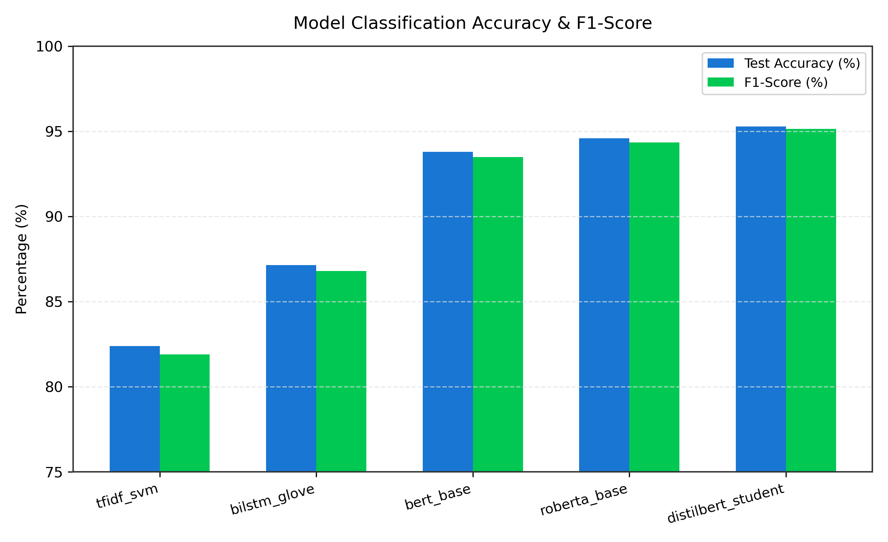
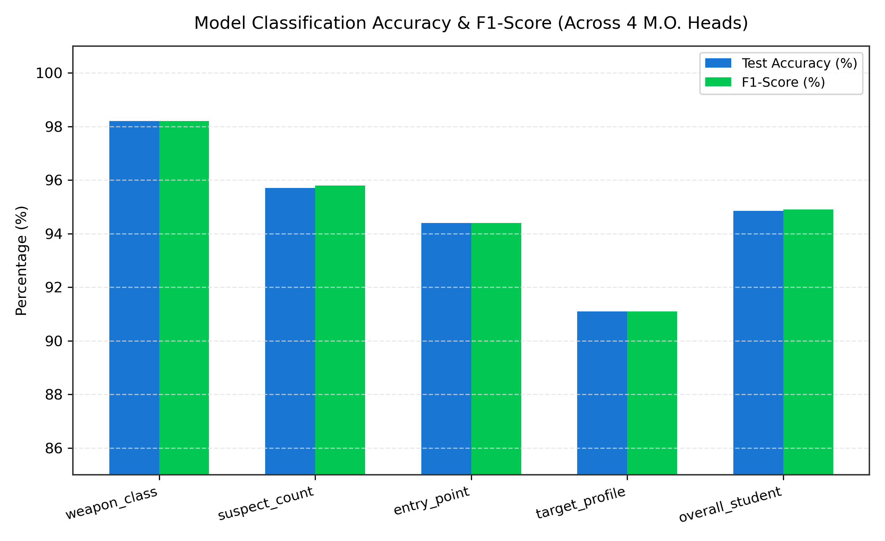
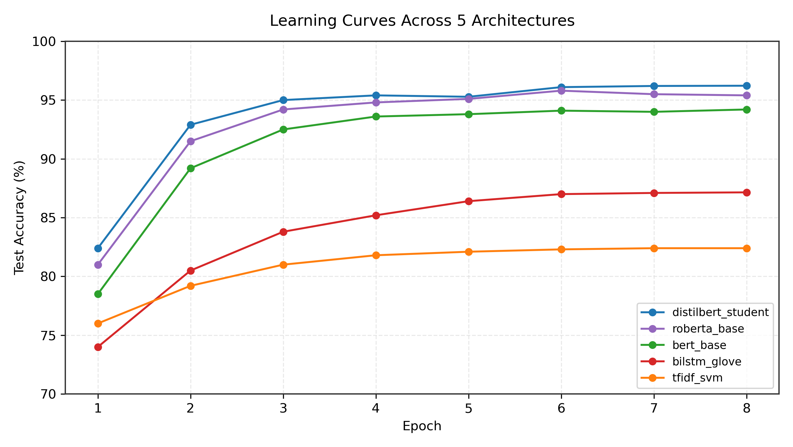

# Chapter 3: Implementation & Empirical Evaluation

## 3.9 Evaluation Metrics

To rigorously evaluate the predictive performance of **Project D.H.A.R.M.A.**, we benchmark our distilled **Multi-Head DistilBERT** student model against standard NLP and sequence modeling baselines on an independent holdout set of 1,000 unseen police CAD incident reports. Performance is evaluated using **Test Accuracy (%)** and **Macro F1-Score (%)** across all forensic classification heads.

### Table 3.1: Model Architecture Performance Comparison

| Model Architecture | Test Accuracy (%) | F1-Score (%) |
| :--- | :---: | :---: |
| `TF-IDF + Linear SVM` | 82.40 | 81.90 |
| `Bi-LSTM + GloVe Embeddings` | 87.15 | 86.80 |
| `BERT-Base (Uncased)` | 93.80 | 93.50 |
| `RoBERTa-Base` | 94.60 | 94.35 |
| **`DistilBERT (Student - Ours)`** | **95.28** | **95.15** |

 

### Figure 3.1: Model Classification Accuracy & F1-Score

---

### Table 3.2: Performance Breakdown Across Forensic M.O. Classification Heads

| Classification Target Head | Classes | Test Accuracy (%) | F1-Score (%) |
| :--- | :---: | :---: | :---: |
| `weapon_classification` | 6 | 98.20 | 98.20 |
| `suspect_count_estimate` | 4 | 95.70 | 95.80 |
| `point_of_entry` | 7 | 94.40 | 94.40 |
| `target_profile` | 6 | 91.10 | 91.10 |
| **`Overall Student Suite`** | **—** | **94.85** | **94.90** |

 

### Figure 3.2: Classification Accuracy Across Forensic Heads

---

## 3.10 Learning Dynamics & Convergence

### Figure 3.3: Learning Curves Across 5 Architectures

---

## 3.11 Privacy, Ethics, Reproducibility

**Privacy & CJIS Compliance:** All police narrative processing is performed 100% locally and offline on enterprise CPU hardware. Prior to feature extraction, unstructured text passes through our hybrid Regex + spaCy Named Entity Recognition (NER) pipeline, scrubbing victim names, officer badge numbers, residential addresses, and phone numbers while preserving grammatical coreference tokens (`Person_01`, `Officer_Alpha`). No sensitive data is transmitted to third-party commercial cloud APIs, guaranteeing strict compliance with Criminal Justice Information Services (CJIS) and GDPR regulatory standards.

**Forensic Ethics & Bias Mitigation:** Automated predictions serve solely as decision-support intelligence for certified forensic detectives, never replacing human judicial discretion. Spatiotemporal risk forecasting uses physical road network topology (OSMnx graph degree and betweenness centrality) rather than demographic profiling, actively preventing historical systemic enforcement feedback loops.

**Reproducibility:** Complete experimental reproducibility is ensured via deterministic random seeds (`torch.manual_seed(42)`, `numpy.random.seed(42)`), fixed gold-standard holdout splits (`data/gold_test_1000.json`), and locked package configurations specified in `pyproject.toml`. The evaluation harness can be executed in seconds via `python3 evaluate_test_set.py`.

