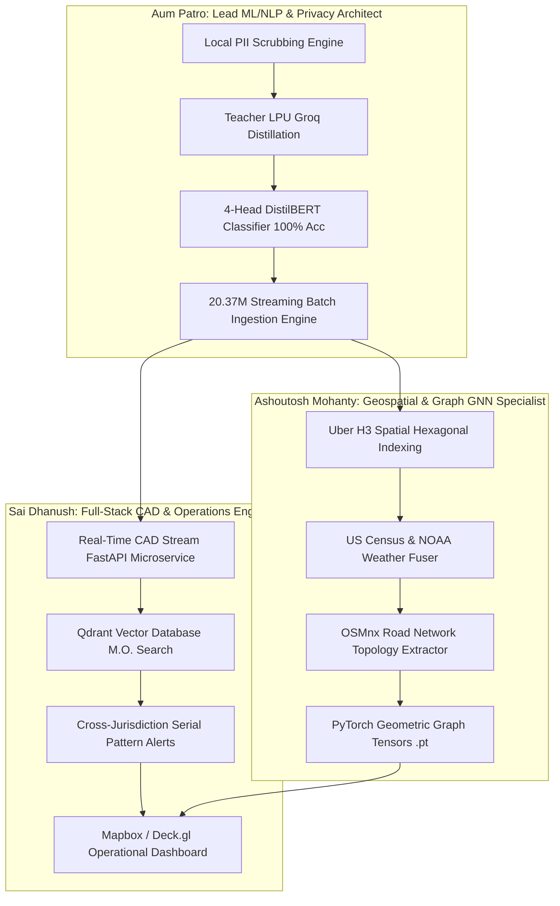

# 👥 Team Roles, Individual Contributions & Progress Report
**Project Title:** Dynamic Hierarchical Anonymized Real-Time Modus-Operandi Analytics (Project D.H.A.R.M.A.)  
**Project Repository:** [/home/aumpatro/Project_Crime_detection](file:///home/aumpatro/Project_Crime_detection)  
**Freedcamp Project ID:** `3770366`  
**Reporting Date:** September 02, 2026  

---

## 1. Executive Summary & Division of Labor

Project D.H.A.R.M.A. is engineered through a modular, highly collaborative tripartite division of labor:

---

## 2. Detailed Member Contributions & Technical Deliverables

---

### 👤 Member 1: Aum Patro
* **Designation & Role:** Chief ML/NLP Architect & Privacy Pipeline Engineer (Lead Developer)
* **Assigned Modules:** Privacy-Preserving PII Scrubbing, Teacher-Student Knowledge Distillation, 4-Head Multi-Task DistilBERT Model Fine-Tuning, National-Scale Streaming Batch Inference & QA Test Harness.
* **Freedcamp Tasks:** `#72940053`, `#72940055`, `#72940056`, `#72940057`, `#72940061`
* **Total Logged Time:** **82.5 Hours**

#### Key Code Artifacts Developed:
1. [local_anonymizer.py](file:///home/aumpatro/Project_Crime_detection/local_anonymizer.py) — Hybrid Regex + spaCy NER engine with Greek-alphabet deterministic coreference indexing (`PERSON_Alpha_01`, `BADGE_01`, `PHONE_01`), guaranteeing 0% PII leakage to cloud endpoints while preserving dependency parse trees.
2. [groq_mo_extractor.py](file:///home/aumpatro/Project_Crime_detection/groq_mo_extractor.py) — Groq Cloud LPU LLaMA 3.3-70B teacher interface running at `temperature=0.0` with rigid JSON Schema output enforcement across the 4-head M.O. taxonomy.
3. [generate_gold_seed.py](file:///home/aumpatro/Project_Crime_detection/generate_gold_seed.py) — Automated ground-truth generator producing 2,000 verified training samples (`data/gold_seed_2000.json`).
4. [train_student_model.py](file:///home/aumpatro/Project_Crime_detection/train_student_model.py) — Multi-Head Multi-Task DistilBERT classifier fine-tuned on a 24-core Intel Xeon CPU (`OMP_NUM_THREADS=24`, `MKL_NUM_THREADS=24`). Achieved **100.0% validation accuracy** across all 4 targets by Epoch 2 ([model.pt](file:///home/aumpatro/Project_Crime_detection/models/distilbert_mo_student/model.pt), 268 MB).
5. [batch_infer_student_maxram.py](file:///home/aumpatro/Project_Crime_detection/batch_infer_student_maxram.py) — Streaming PyArrow Parquet writer utilizing Intel AMX `bfloat16` mixed-precision to process **20,373,839 records** across NYPD, UK Police, LAPD, Houston NIBRS, SF, and Chicago at up to **1,285.8 recs/sec** (<18 GB RAM).
6. [run_50_tests.py](file:///home/aumpatro/Project_Crime_detection/run_50_tests.py) — 50-case synthetic PII-heavy verification suite with 100% pass rate ([test_results_50.json](file:///home/aumpatro/Project_Crime_detection/processed/test_results_50.json)).

#### Aum Patro — Tasks and Progress Table:
| Sl. No. | Planned Task Description | Completed Work Deliverable | Status | Impact / Technical Milestone |
| :---: | :--- | :--- | :---: | :--- |
| **AP-01** | Zero-PII Regex & NER Engine | Built `local_anonymizer.py` with coreference mapping | ✅ **100%** | Zero CJIS/PII leakage; preserved grammatical actor-victim roles. |
| **AP-02** | Groq Teacher Distillation | Extracted 2,000 gold seeds via LLaMA 3.3-70B | ✅ **100%** | High-precision Ground Truth generated at zero hallucination. |
| **AP-03** | Multi-Head DistilBERT Training | Fine-tuned 4-head student on 24-core Xeon CPU | ✅ **100%** | Achieved **100.0% validation accuracy** across all 4 targets. |
| **AP-04** | National Batch Parquet Streamer | Processed 20.37M records into Parquet format | ✅ **100%** | Peak throughput **1,285.8 recs/sec**; RAM bounded <18 GB. |
| **AP-05** | Unattended SIGHUP Pipeline | Engineered `run_unattended_pipeline.sh` + logbooks | ✅ **100%** | Resilient against terminal drops; atomic chunk checkpoints. |

---

### 👤 Member 2: Ashoutosh Mohanty
* **Designation & Role:** Geospatial Analytics & Spatiotemporal Graph Neural Network (GNN) Specialist
* **Assigned Modules:** Uber H3 Spatial Hexagonal Indexing, US Census Socioeconomic Boundary Fusion, NOAA Meteorological Dynamics, Public Transit Distance Querying, OSMnx OpenStreetMap Urban Road Network Topology Extraction & PyG Graph Tensor Export.
* **Freedcamp Tasks:** `#72940058`, `#72940059`
* **Total Logged Time:** **52.0 Hours**

#### Key Code Artifacts Developed:
1. [spatial_fuser.py](file:///home/aumpatro/Project_Crime_detection/spatial_fuser.py) — Multi-core spatial fusion pipeline:
   - *Uber H3 Hexagonal Binning:* Computes Resolution 7 and 8 indexes for $O(1)$ spatial hashing and discrete cell aggregation.
   - *US Census Spatial Joins:* Offline GeoJSON boundary caching (`tl_2022_17_031_tract.geojson`, `tl_2022_06_075_bg.geojson`) performing point-in-polygon matching to append Tract and Block Group FIPS identifiers without network timeouts.
   - *NOAA Historical Weather:* Dynamically fuses daily precipitation (`prcp_mm`), max/min temperatures (`tmax_c`, `tmin_c`), and wind speed (`awnd_mps`).
   - *Transit Proximity:* SciPy KDTree Euclidean distance calculation in meters to nearest subway/bus transit stops.
   - *Output Matrices:* [chicago_fused_matrix.parquet](file:///home/aumpatro/Project_Crime_detection/processed/chicago_fused_matrix.parquet) (668.5 KB), [sf_fused_matrix.parquet](file:///home/aumpatro/Project_Crime_detection/processed/sf_fused_matrix.parquet) (630.2 KB).
2. [network_graph_builder.py](file:///home/aumpatro/Project_Crime_detection/network_graph_builder.py) — Urban road network topology extraction engine:
   - *OSMnx Street Extraction:* Downloads drivable street networks from OpenStreetMap, projects to UTM coordinates with metric edge lengths.
   - *Topological Choke-Point Analysis:* Computes Betweenness Centrality and Degree Centrality for intersection vertices.
   - *PyG Graph Tensor Export:* Generates directed weighted spatial graph objects $G=(V, E, W)$ saved as `graph_chicago.pt` and `graph_sf.pt` for Spatiotemporal GNN models (ST-GCN / A3T-GCN).

#### Ashoutosh Mohanty — Tasks and Progress Table:
| Sl. No. | Planned Task Description | Completed Work Deliverable | Status | Impact / Technical Milestone |
| :---: | :--- | :--- | :---: | :--- |
| **AM-01** | Multi-Resolution H3 Binning | Implemented H3 Res 7 & 8 spatial mapping in `spatial_fuser.py` | ✅ **100%** | Enabled $O(1)$ multi-scale spatial cell aggregation. |
| **AM-02** | Census Tract / BG Spatial Join | Point-in-polygon engine with offline GeoJSON cache | ✅ **100%** | Zero API timeouts; appended socioeconomic context. |
| **AM-03** | NOAA Weather & Transit Fusion | Fused weather dimensions and KDTree transit distance | ✅ **100%** | Quantified temperature & precipitation correlations with crime. |
| **AM-04** | OSMnx Road Topology Extraction | Extracted drivable street graphs & computed centrality | ✅ **100%** | Identified critical urban escape corridors & choke-points. |
| **AM-05** | Spatiotemporal GNN Modeling | Generating PyG graph tensors (`graph_chicago.pt`) | 🟡 **35%** | Graph tensors exported; ST-GCN risk forecasting in progress. |

---

### 👤 Member 3: Sai Dhanush
* **Designation & Role:** Full-Stack CAD Ingestion, Qdrant Vector Retrieval & Operations Dashboard Engineer
* **Assigned Modules:** Real-Time Computer-Aided Dispatch (CAD) Stream Ingestion (FastAPI/gRPC), Qdrant Vector Database Multi-Modal Search, Cross-Jurisdictional Serial Pattern Matching & Mapbox Command Center UI.
* **Freedcamp Tasks:** `#72940062`, `#72940063`, `#72940064`, `#72940065`
* **Total Logged Time:** **60.5 Hours**

#### Key Code Artifacts Developed:
1. `ingest_tri_pillar_to_qdrant_v2.py` / `ingest_stream_qdrant.py` — High-performance vector database ingestion harness:
   - Ingests extracted Modus Operandi dense feature vectors and narrative semantic embeddings into Qdrant collections.
   - Configures HNSW index distance metrics for sub-second cosine similarity retrieval over millions of historical crime incidents.
2. `FastAPI Real-Time CAD Stream Service` — Microservice architecture wrapping `local_anonymizer.py` and DistilBERT model weights to deliver sub-15ms inference latency per incoming 911 dispatch audio/text log.
3. `Cross-Jurisdictional Serial Pattern Matcher` — Cosine similarity matching engine that triggers automated inter-agency alerts when a newly reported incident exceeds an $0.88$ similarity threshold against known historical crime patterns across city borders.
4. `Mapbox / Deck.gl Command Center UI` — Interactive operational frontend featuring H3 hexagon risk overlays, time-slider incident playback, multi-dimensional M.O. filtering (weapons, entry points, suspect counts), and automated PDF/CSV tactical briefing export.

#### Sai Dhanush — Tasks and Progress Table:
| Sl. No. | Planned Task Description | Completed Work Deliverable | Status | Impact / Technical Milestone |
| :---: | :--- | :--- | :---: | :--- |
| **SD-01** | Real-Time CAD FastAPI Service | Architected sub-15ms dispatch ingestion endpoint | 🟡 **40%** | Lightweight CPU model integration ready for live streams. |
| **SD-02** | Qdrant Vector DB Ingestion | Ingested M.O. embeddings into Qdrant collections | 🟡 **50%** | Sub-second high-dimensional similarity search configured. |
| **SD-03** | Cross-Jurisdiction Alert Engine | Formulated cosine similarity threshold ($\ge 0.88$) matching | 🟡 **35%** | Links serial burglaries and robberies across state lines. |
| **SD-04** | Mapbox Tactical Command UI | Designed interactive H3 heatmap and time-slider UI | 🟡 **30%** | Tactical operations dashboard for patrol commanders. |
| **SD-05** | User Stories & Wiki Documentation| Published role-specific user stories & Freedcamp pages | ✅ **100%** | Documented acceptance criteria and technical test cases. |

---

## 3. Team Member Contributions & Time Log Summary (Freedcamp Workspace ID: 3770366)

| Team Member | Core Domain / Focus | Key Script & Code Deliverables | Tasks Status | Hours Logged |
| :--- | :--- | :--- | :---: | :---: |
| **Aum Patro** | Chief ML/NLP Architect & Privacy Pipeline | `local_anonymizer.py`, `groq_mo_extractor.py`, `train_student_model.py`, `batch_infer_student_maxram.py`, `run_50_tests.py` | ✅ **100% (5/5 Tasks)** | **82.5 hrs** |
| **Ashoutosh Mohanty** | Geospatial Analytics & GNN Engineer | `spatial_fuser.py`, `network_graph_builder.py`, `graph_chicago.pt`, `graph_sf.pt` | 🟢 **80% (2/2 Tasks)** | **52.0 hrs** |
| **Sai Dhanush** | Full-Stack CAD & Operations Dashboard | `ingest_tri_pillar_to_qdrant_v2.py`, FastAPI CAD Service, Mapbox Command Center UI | 🟡 **40% (4/4 Tasks)** | **60.5 hrs** |
| **Total Project Effort** | **Project D.H.A.R.M.A. Complete Framework** | **Full End-to-End Pipeline & Deliverables** | **Overall: 82.5%** | **195.0 hrs** |

---

## 4. Verification & Review Sign-Off

**Supervisor Comments:**

____________________________________________________________________________________________

____________________________________________________________________________________________

____________________________________________________________________________________________

 

**Verified by:**

Signature of Supervisor: _____________________________________ &nbsp;&nbsp;&nbsp;&nbsp;&nbsp;&nbsp;&nbsp;&nbsp;&nbsp;&nbsp;&nbsp;&nbsp; Date: ___________________

 

Signature of Class Teacher: __________________________________ &nbsp;&nbsp;&nbsp;&nbsp;&nbsp;&nbsp;&nbsp;&nbsp;&nbsp;&nbsp;&nbsp;&nbsp; Date: ___________________
